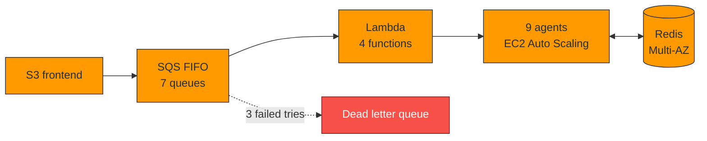

  
  

  
  
  

  
  
  
  

<h3>I build and study the layers underneath applications: distributed systems, networks, and operating systems.</h3>

<table align="center" width="100%">
  <tr>
    <td width="50%" valign="top">
<pre>
$ whoami
eyouel_kibret  # friends call me Prime

$ cat certification.txt
AWS Certified Solutions Architect

$ cat education.txt
M.S. Computer Science
George Washington University
GPA: 4.0

$ cat role.txt
Technical Projects Graduate Ambassador
GW Open Source Program Office

$ pwd
Washington, DC

$ cat status.txt
Open to backend, cloud, and systems roles
</pre>
    </td>
    <td width="50%" valign="middle">
      <table width="100%">
        <tr>
          <td align="center"><h1>9</h1>AI agents in Debatrium</td>
          <td align="center"><h1>7</h1>SQS FIFO queues</td>
        </tr>
        <tr>
          <td align="center"><h1>30s</h1>crash recovery target</td>
          <td align="center"><h1>6</h1>parallel streaming queries</td>
        </tr>
        <tr>
          <td align="center"><h1>3</h1>layers I obsess over</td>
          <td align="center"><h1>AWS</h1>Solutions Architect</td>
        </tr>
      </table>
    </td>
  </tr>
</table>

<table align="center" width="100%">
  <tr>
    <td width="33%" valign="top" align="center">
      
      
<i>Machines fail. Messages repeat. I plan for it.</i>

      
Queues and retries Redis locks Crash recovery Kafka, Spark, Cassandra

    </td>
    <td width="33%" valign="top" align="center">
      
      
<i>From the zone file to the backbone.</i>

      
MPLS, PE, and CPE Metro provisioning DNS and DNSSEC NOC observability

    </td>
    <td width="33%" valign="top" align="center">
      
      
<i>I want to know what the machine is really doing.</i>

      
Multithreaded C++ Memory hierarchy Native code debugging Linux and Docker

    </td>
  </tr>
</table>

<table align="center" width="100%">
  <tr>
    <td width="33%" valign="top" align="center">
      
      
A nine agent GPT-4o debate system that survives crashes. I led the infrastructure.

      
    </td>
    <td width="33%" valign="top" align="center">
      
      
A Scala streaming pipeline with six parallel queries, plus a Medium article on the design.

      
    </td>
    <td width="33%" valign="top" align="center">
      
      
Authoritative BIND9, recursive Unbound with DNSSEC, and DoH and DoT through dnsdist.

      
    </td>
  </tr>
  <tr>
    <td width="33%" valign="top" align="center">
      
      
An open source gRPC serial plugin, and a nasty protobuf segfault fixed along the way.

      
    </td>
    <td width="33%" valign="top" align="center">
      
      
Deployed on AWS Linux with Docker for the GW Open Source Program Office.

      
    </td>
    <td width="33%" valign="top" align="center">
      
      
My own site, with a playable chess game and a working terminal emulator.

      
    </td>
  </tr>
</table>

<b>Debatrium, simplified</b>

<b>🛡️ How Debatrium stays up</b>

 
<ul>
  <li>A Redis <code>SET NX</code> lock means only one worker can claim a turn.</li>
  <li>Keys are namespaced by round, and writes are idempotent, so a replayed message cannot corrupt state.</li>
  <li>Heartbeats reveal a dead worker, and recovery lands within about 30 seconds.</li>
  <li>Exponential backoff, a fast fail on <code>insufficient_quota</code>, and dead letter queues after three attempts.</li>
</ul>

<b>🐛 Story time: the segfault hiding in a JSON call</b>

 
While building the gRPC serial plugin for MetaCall, I hit a critical segfault that traced back to the Protobuf JSON API calls. Instead of working around it, I replaced those calls with a hand written recursive serializer. The crash went away, and I understood the data path far better than before.

<table align="center" width="100%">
  <tr>
    <td width="33%" valign="top">
      <h4>WebSprix</h4>
      
<b>Software Engineer, private ISP</b>

      <ul>
        <li>NS manager for domains, records, and DNS</li>
        <li>Business manager that provisions metro network devices from a topology tree</li>
        <li>MPLS backbone, PE, and CPE</li>
        <li>NOC observability tool</li>
      </ul>
    </td>
    <td width="33%" valign="top">
      <h4>University of Michigan</h4>
      
<b>Research Intern</b>

      <ul>
        <li>Multithreaded C++ for embeddings, shaped by the memory hierarchy</li>
      </ul>
    </td>
    <td width="33%" valign="top">
      <h4>GW Open Source Program Office</h4>
      
<b>Technical Projects Graduate Ambassador</b>

      <ul>
        <li>Deployed a UN SDG classifier on AWS with Docker</li>
      </ul>
    </td>
  </tr>
</table>

<b>Beyond the terminal:</b> comedy movies (The Office is near the top), chess, and open source systems code.

<b>🎲 Press for a joke</b>

 
There are two hard problems in distributed systems: 2. Exactly once delivery. 1. Guaranteed order. 2. Exactly once delivery.

<h3>I like to build tools so that people own them, not just use them.</h3>

