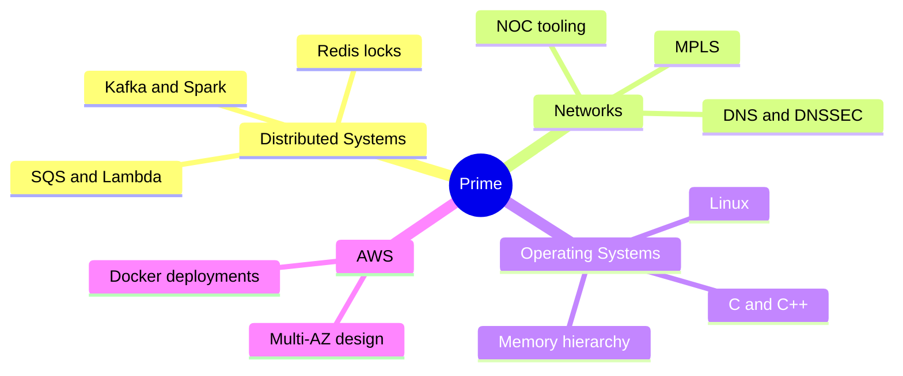
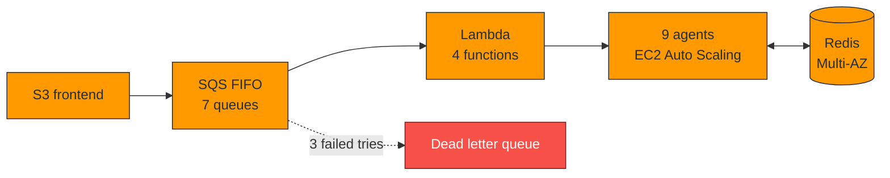
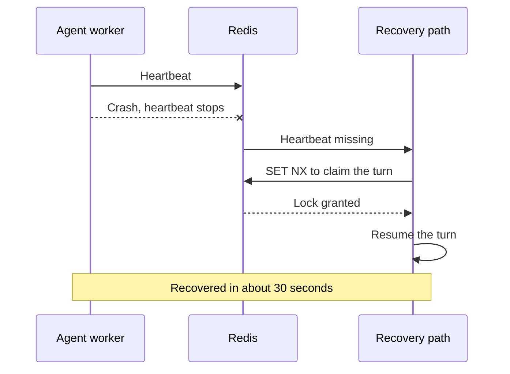
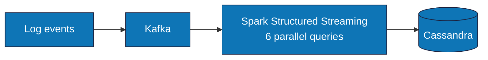
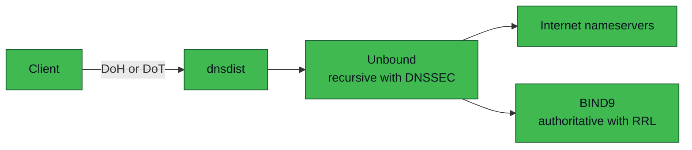

<h3>I build and study the layers underneath applications. I am an AWS Certified Solutions Architect and an M.S. Computer Science student at George Washington University, based in Washington, DC.</h3>

  
  

  
  
  

  
  
  
  

<h2>🗺️ My World</h2>

<h2>🚀 What I Am Up To</h2>

- **GW Open Source Program Office:** as a Technical Projects Graduate Ambassador, I deployed a UN SDG classifier tool on AWS Linux with Docker, so the tool is easy for others to run and own.
- **MetaCall:** I contributed a gRPC serial plugin to this open source project and fixed a protobuf segfault along the way.
- **DNS infrastructure:** I built an authoritative and recursive DNS stack with BIND9, Unbound, DNSSEC, and dnsdist.

<h2>💥 Debatrium: Nine AI Agents That Survive Crashes</h2>

A fault tolerant GPT-4o debate system on AWS, built for my distributed systems course. I served as infrastructure lead.

<b>What happens when an agent crashes</b>

<h2>📈 LogAggregator: Streaming Logs in Scala</h2>

<h2>🌐 My DNS Stack</h2>

<h2>🔓 Click to Open</h2>

<b>🕸️ Distributed Systems</b>

 
<ul>
  <li>Queues, retries, exponential backoff, and dead letter queues that stop after three failed receives</li>
  <li>Redis <code>SET NX</code> locks, round namespaced keys, and idempotent writes so a replayed message cannot corrupt state</li>
  <li>Heartbeat based crash recovery with a 30 second target</li>
  <li>Streaming pipelines with Kafka, Spark Structured Streaming, and Cassandra</li>
</ul>

<b>🌐 Networks</b>

 
<ul>
  <li>MPLS backbone, PE, and CPE configuration at a private ISP</li>
  <li>A business manager that configures metro network devices and maps them in a topology tree for provisioning</li>
  <li>An NS manager for domains and records, plus authoritative and recursive DNS with DNSSEC, DoH, and DoT</li>
  <li>A network observability tool for the NOC team</li>
</ul>

<b>🐧 Operating Systems</b>

 
<ul>
  <li>Multithreaded C++ for embedding workloads, shaped by the memory hierarchy</li>
  <li>Native code debugging, including a critical protobuf segfault</li>
  <li>Linux deployments with Docker on AWS</li>
</ul>

<b>☁️ AWS</b>

 
I design for failure first, then for cost and speed. I have built with SQS FIFO, Lambda, ElastiCache Redis Multi-AZ, EC2 Auto Scaling Groups, and S3 static hosting. My data engineering coursework covered Redshift, EMR, Athena, Kinesis, and Glue.

<b>💼 Experience</b>

 
<ul>
  <li><b>WebSprix, Software Engineer (private ISP):</b> NS manager, business manager, MPLS backbone, PE and CPE, and NOC observability</li>
  <li><b>University of Michigan, Research Intern:</b> multithreaded C++ for embeddings using memory hierarchies</li>
  <li><b>GW Open Source Program Office, Technical Projects Graduate Ambassador:</b> UN SDG classifier on AWS</li>
</ul>

<b>🛠️ Story time: the segfault hiding in a JSON call</b>

 
While building the gRPC serial plugin for MetaCall, I hit a critical segfault that traced back to the Protobuf JSON API calls. Instead of working around it, I replaced those calls with a hand written recursive serializer. The crash went away, and I understood the data path far better than I would have by patching around it.

<b>🎲 Press for a joke</b>

 
There are two hard problems in distributed systems: 2. Exactly once delivery. 1. Guaranteed order. 2. Exactly once delivery.

<h2>🧰 Toolbox</h2>

<b>Beyond the terminal:</b> comedy movies (The Office is near the top), chess, and open source systems code.

<h3>I like to build tools so that people own them, not just use them.</h3>

