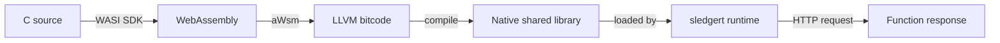

<h3>I build and study the layers underneath applications: serverless runtimes, distributed systems, and the networks that carry them.</h3>

  
  
  
  

<h2 align="center">⚡ At a Glance</h2>

<table align="center" width="100%">
  <tr>
    <td width="50%" valign="top">
<pre>
$ whoami
eyouel_kibret 

$ cat role.txt
Graduate Research Assistant, GW Systems Lab
Technical Projects Graduate Ambassador, GW OSPO

$ cat education.txt
M.S. Computer Science, George Washington University
GPA: 4.0

$ pwd
Washington, DC  (originally Addis Ababa, Ethiopia)

$ cat looking_for.txt
Backend, cloud infrastructure, and systems roles
</pre>
    </td>
    <td width="50%" valign="top">
      <table width="100%">
        <tr>
          <td align="center"><h1>9</h1>AI agents coordinated in Debatrium</td>
          <td align="center"><h1>7</h1>SQS FIFO queues wired together</td>
        </tr>
        <tr>
          <td align="center"><h1>30s</h1>crash recovery target</td>
          <td align="center"><h1>6</h1>parallel Spark streaming queries</td>
        </tr>
        <tr>
          <td align="center"><h1>5</h1>build failures diagnosed in one SLEdge onboarding</td>
          <td align="center"><h1>2</h1>continents of engineering experience</td>
        </tr>
      </table>
    </td>
  </tr>
</table>

<h2 align="center">🚀 What I Am Working On Now</h2>

<table align="center" width="100%">
  <tr>
    <td width="33%" valign="top">
      <h4>🔬 GW Systems Lab</h4>
      
My current research is on <b>SLEdge</b>, a serverless computing framework. I am porting SeBS benchmarks and tracing how the runtime manages memory, working under Professor Timothy Wood.

    </td>
    <td width="33%" valign="top">
      <h4>☁️ GW Open Source Program Office</h4>
      
As a Technical Projects Graduate Ambassador, I deployed a UN SDG classifier tool on AWS Linux using Docker, so the tool is easy for others to run and own.

    </td>
    <td width="33%" valign="top">
      <h4>🧩 MetaCall</h4>
      
I contributed a gRPC serial plugin and fixed a protobuf segfault by replacing the JSON API calls with a hand written recursive serializer.

    </td>
  </tr>
</table>

<h3 align="center">How a C function becomes a serverless function in SLEdge</h3>

<i>The pipeline I learned end to end, and ran with my own custom C function.</i>

<b>🛠️ Story time: five build failures on one laptop</b>

 
When I started with SLEdge on Apple Silicon, the build broke five different ways. I diagnosed and fixed every one, and that forced me to learn how the whole toolchain fits together instead of just running it. The payoff was a custom C function running end to end, and a much better feel for where the runtime keeps its memory.

<h2 align="center">🧱 Selected Projects</h2>

<table align="center" width="100%">
  <tr>
    <td width="50%" valign="top">
      <h3>🗣️ Debatrium</h3>
      
<i>A fault tolerant, nine agent GPT-4o debate system on AWS. I served as infrastructure lead.</i>

      <ul>
        <li>Seven SQS FIFO queues, four Lambda functions, ElastiCache Redis Multi-AZ, and EC2 Auto Scaling Groups</li>
        <li>Atomic dispatch locks with Redis <code>SET NX</code> and idempotent writes</li>
        <li>Heartbeat based crash recovery with a 30 second target</li>
        <li>Exponential backoff and dead letter queues that stop after three failed receives</li>
      </ul>
    </td>
    <td width="50%" valign="top">
      <h3>📈 LogAggregator</h3>
      
<i>A streaming log pipeline written in Scala.</i>

      <ul>
        <li>Kafka for ingestion, Spark Structured Streaming for processing, Cassandra for storage</li>
        <li>Six parallel streaming queries</li>
        <li>I wrote a Medium article on the design</li>
      </ul>
    </td>
  </tr>
  <tr>
    <td width="50%" valign="top">
      <h3>🌐 DNS Infrastructure Lab</h3>
      
<i>A full authoritative and recursive DNS stack.</i>

      <ul>
        <li>BIND9 as an authoritative nameserver</li>
        <li>Unbound as a public recursive resolver with DNSSEC</li>
        <li>Response rate limiting, plus DNS over HTTPS and TLS through dnsdist</li>
      </ul>
    </td>
    <td width="50%" valign="top">
      <h3>♟️ Interactive Portfolio</h3>
      
<i>My personal site, built to be played with.</i>

      <ul>
        <li>A playable chess game and a working terminal emulator</li>
        <li>A section on Ethiopian culture</li>
        <li><a href="https://portfolio.eyouel-kibret.dev.et/">Come and click around</a></li>
      </ul>
    </td>
  </tr>
</table>

<b>🔍 Debatrium reliability patterns, in more detail</b>

 
<ul>
  <li><b>Atomic dispatch:</b> a Redis <code>SET NX</code> lock means only one worker can claim a turn.</li>
  <li><b>Round namespaced keys:</b> state from one debate round can never leak into the next.</li>
  <li><b>Idempotent writes:</b> retries use <code>hset</code>, so a replayed message cannot corrupt state.</li>
  <li><b>Crash recovery:</b> heartbeats let the system notice a dead worker and recover within about 30 seconds.</li>
  <li><b>Failure handling:</b> exponential backoff, a fast fail on <code>insufficient_quota</code>, and dead letter queues after three attempts.</li>
</ul>

<h2 align="center">💼 Experience</h2>

<table align="center" width="100%">
  <tr>
    <td width="50%" valign="top">
      <h3>WebSprix, Addis Ababa</h3>
      
<b>Software Engineer</b>

      <ul>
        <li>Built an NS manager that handles domains and records for the company and improved its DNS infrastructure</li>
        <li>Built a business manager that configures network devices across metro networks and maps them in a topology tree for provisioning</li>
        <li>Configured MPLS backbone, PE, and CPE equipment, and built a network observability tool for the NOC team</li>
      </ul>
    </td>
    <td width="50%" valign="top">
      <h3>University of Michigan</h3>
      
<b>Research Intern</b>

      <ul>
        <li>Wrote multithreaded C++ for embedding workloads that make use of the memory hierarchy</li>
      </ul>
    </td>
  </tr>
</table>

<h2 align="center">🧰 Toolbox</h2>

   
   
  

<b>Ask me about:</b> serverless runtimes, WebAssembly toolchains, queues and retries, Redis locking, DNS from the zone file to DNSSEC, MPLS networks, and Nginx

<h2 align="center">🎲 Beyond the Terminal</h2>

<table align="center" width="100%">
  <tr>
    <td width="33%" valign="top">
      <h4>🎬 Comedy movies</h4>
      
I am a huge fan, and The Office sits near the top of my list.

    </td>
    <td width="33%" valign="top">
      <h4>♟️ Chess</h4>
      
I like the game enough that I put one inside my portfolio website.

    </td>
    <td width="33%" valign="top">
      <h4>🇪🇹 Ethiopian roots</h4>
      
I grew up in Addis Ababa, and my portfolio has a section on the culture I come from.

    </td>
  </tr>
</table>

<i>My favorite distributed systems joke: there are two hard problems. 2. Exactly once delivery. 1. Guaranteed order. 2. Exactly once delivery.</i>

<h2 align="center">📊 GitHub Activity</h2>

  
  

<h3>Open to software engineering and research roles in backend, cloud infrastructure, and systems.</h3>

I like to build tools so that people own them, not just use them. If you are building something that needs to scale and stay up, I would like to hear about it.

  

  
  

