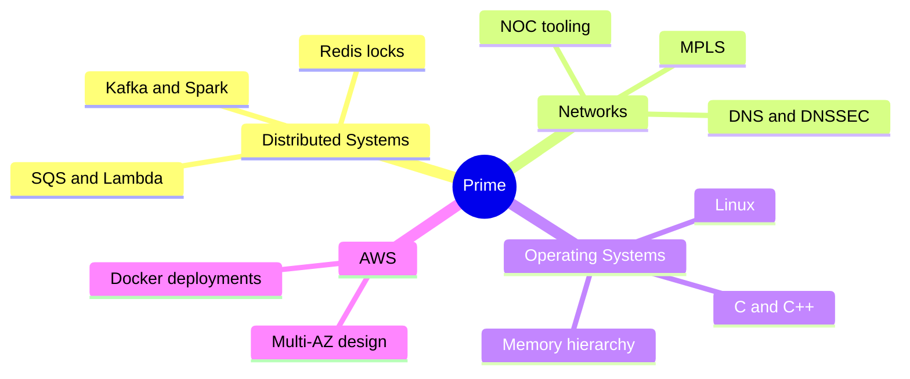
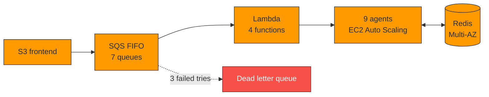

  
  

  
  
  

  
  
  
  

<h2>🗺️ My World</h2>

<h2>💥 Debatrium, Simplified</h2>

<h2>🔓 Click to Open</h2>

<b>🕸️ Distributed Systems</b>

 
Queues, retries, dead letter queues, Redis <code>SET NX</code> locks, idempotent writes, and 30 second crash recovery.

<b>🌐 Networks</b>

 
MPLS backbone, PE and CPE, metro provisioning, authoritative and recursive DNS with DNSSEC, and NOC tooling.

<b>🐧 Operating Systems</b>

 
Multithreaded C++ shaped by the memory hierarchy, native code debugging, and Linux deployments.

<b>🧱 Projects</b>

 
<b>Debatrium</b> (nine agent GPT-4o system on AWS, I led infrastructure), <b>LogAggregator</b> (Kafka, Spark, Cassandra), <b>DNS lab</b> (BIND9, Unbound, dnsdist), <b>MetaCall</b> (gRPC serial plugin and a segfault fix), and my <b>portfolio</b> (with a playable chess game).

<b>💼 Experience</b>

 
<b>WebSprix</b>, Software Engineer at a private ISP. <b>University of Michigan</b>, Research Intern. <b>GW Open Source Program Office</b>, Technical Projects Graduate Ambassador.

<b>🎲 Press for a joke</b>

 
There are two hard problems in distributed systems: 2. Exactly once delivery. 1. Guaranteed order. 2. Exactly once delivery.

<h2>🧰 Toolbox</h2>

  

